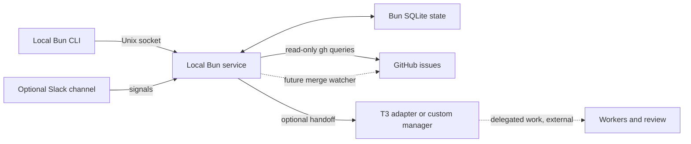

# Portable harness v1

This local Bun prototype attaches repositories, discovers GitHub issues through read-only `gh` queries, and can hand candidates to an opt-in T3 manager adapter or an operator-provided manager executable. Its independent service owns SQLite state and accepts CLI requests over a Unix socket. No worker, review agent, merge watcher, or production supervisor is bundled. The manager executable is responsible for validating work and delegating it; a handoff or reported outcome is not proof of checks, merge, deployment, or acceptance. Treat this as a prototype, not a production activation.



## Quickstart

From this directory, with Bun and an authenticated GitHub CLI installed, create `.harness.toml` at the checkout root. Substitute a real repository and GitHub login:

```toml
[repository]
github = "example-org/billing"

[standing_goal]
enabled = true
github_assignee_allowlist = ["example-login"]
```

```sh
bun src/cli.ts service start
bun src/cli.ts repo attach /path/to/billing
bun src/cli.ts repo list
bun src/cli.ts wake --repo example-org/billing
bun src/cli.ts status --repo example-org/billing
bun src/cli.ts goal pause --repo example-org/billing
bun src/cli.ts goal resume --repo example-org/billing
bun src/cli.ts goal show --repo example-org/billing
bun src/cli.ts goal set --repo example-org/billing --objective 'Ship the billing milestone' --priority 123,456 --expected-revision 0
bun src/cli.ts service status
bun src/cli.ts service stop
bun src/cli.ts service shutdown
```

`service start` launches a detached local process. Add `--json` to commands for JSON output. Reattach a checkout after changing its configuration. Use the GitHub `owner/repository`, checkout path, or an unambiguous directory name as the project identifier.

Discovery requires an enabled goal and nonempty assignee allowlist, and returns at most 1,000 open issues per assignee. These are candidates: dependencies and actionability are not verified. The service reconciles enabled projects at startup and every 300 seconds by default; set `HARNESS_RECONCILE=0` before starting to disable periodic polling, or set `HARNESS_RECONCILE_SECONDS` to change its interval. Wake and resume explicitly reconcile. Pause persists across restarts and prevents new manager handoffs; wake can still refresh candidates. Check status for discovery errors.

`goal show` displays the saved objective, priority issue numbers, and revision; add `--json` for machine-readable output. `goal set` replaces both the objective and the complete priority order: include every priority issue in the desired order, or use `--priority none` to clear it. Use `--expected-revision` from `goal show` to reject an update if someone else changed the goal; omit it to replace the current goal unconditionally. The objective is context for the manager, not an issue search or queue selector. Priority numbers order eligible discovered candidates; they do not make issues eligible or interrupt active work. Other candidates follow in issue-number order. An enabled, unpaused project is reconciled after a saved change.

A goal change does not release existing blocked claims, including claims made under an earlier goal. Once the blocker has cleared, use `goal retry --repo <name> --issue <number>` to release that claim for consideration under the current goal.

State and socket default to `~/.local/state/portable-harness`; set `HARNESS_STATE_DIR` consistently for service and CLI to use another directory. Shared settings are read from `~/.config/portable-harness/config.toml` when present; set `HARNESS_CONFIG` to select another file. Environment variables override shared state and polling settings. `shared/config.toml` is an example, not automatically installed.

## Optional manager

Manager execution is off by default. Set `HARNESS_MANAGER=t3` in the environment of the service **before starting it** to use the bundled adapter. This is a local process setting; it does not activate T3 globally or enable other services. An absolute `HARNESS_MANAGER_BIN` takes precedence and selects an operator-provided executable instead. A relative `HARNESS_MANAGER_BIN` is rejected. Restart the service after changing its environment; attaching or starting an enabled project can trigger a handoff immediately.

The service sends one JSON object on standard input containing `run_id`, `project`, `root`, `issue`, the goal snapshot, `contexts`, `context_command`, and instructions. A custom executable must exit successfully and return exactly one JSON object on standard output with `outcome` (`complete`, `blocked`, or `out_of_scope`) and a nonempty `summary`. A custom manager may opt in to `out_of_scope` only for a valid issue outside a nonempty objective; use `blocked` for actual blockers. The manager must validate actionability and policy and arrange delegated execution and independent review using `gpt-6.1-terra`; the harness asks for that model but does not enforce the model used by T3 or verify reported results. The checkout must have a Git `origin` matching the configured GitHub repository before handoff. Detached service output is discarded; inspect status for recorded errors.

### T3 adapter

The adapter requires an already-running T3 service, an existing T3 project and an existing manager thread. Set these in the service environment:

- `HARNESS_T3_PROJECT_ID` and `HARNESS_T3_THREAD_ID`: required explicit IDs. The adapter does not create or select a thread automatically.
- `HARNESS_T3_BIN`: absolute path to the T3 executable; defaults to `~/.t3/bin/t3`.
- `HARNESS_T3_TIMEOUT_SECONDS`: adapter deadline, default 3300 seconds, maximum 82800. `HARNESS_MANAGER_TIMEOUT_SECONDS` controls the outer handoff timeout, default 3600 seconds, maximum 86400; allow enough time for the adapter deadline.

The installed T3 CLI supports `thread list --project PATH --json`, `thread show --messages 0 --json THREAD_ID`, and `thread send --wait --json THREAD_ID -` for a message on stdin. Use the list and show commands to inspect IDs and thread state before activation. The adapter checks the selected thread through listings by project ID and checkout path, requires it to be settled in a terminal or idle state with no background tasks or pending requests, checks its project and any worktree path, validates the checkout origin, and checks the exact project root using T3’s local SQLite projection. That projection is an internal, schema-sensitive interface; an incompatible T3 version fails preflight. It sends a manager-only instruction requiring delegated implementation and independent review, then accepts only a correlated terminal result with specific evidence. These checks and the manager's report are not independent verification of the work.

A preflight failure before sending, including missing settings or a busy or mismatched thread, records a `deferred` claim and retries at the next normal reconciliation or manual wake; it does not immediately loop. Once sending begins, command failures, timeouts, malformed replies, or uncertain outcomes cause a `needs attention` claim and stop further handoffs for that project. Inspect the thread and any workers before resolving the claim; do not assume they stopped just because a command timed out. T3's CLI may queue a message if a thread becomes busy between the adapter's check and send, so avoid using the selected manager thread for other work. The CLI itself does not enforce worker role or model selection.

### Activating Finance Mesh

1. In the Finance Mesh checkout, create `.harness.toml` with `[repository] github = "eliza-hq/finance_mesh"` and `[standing_goal] enabled = true` plus a nonempty `github_assignee_allowlist` of verified GitHub logins. The example under `examples/finance-mesh.harness.toml` is illustrative and its empty allowlist disables dispatch. Confirm `gh` authentication and the checkout's matching `origin`.
2. The discovered Finance Mesh work orchestrator #1 uses project ID `2f9dd6f2-5939-438c-91ff-e0f12a35daac` and thread ID `mcp:launch:87b979373343be0155b8606693435168d725a9d83cc9cf4ec4c8eed1118ce44d`. Reconfirm that these still identify the intended dedicated settled manager thread for the checkout before use. Run `t3 thread list --project /absolute/path/to/finance_mesh --json` and `t3 thread show --messages 0 --json THREAD_ID` to inspect the returned project and thread IDs and state. Confirm the active runtime can delegate execution and independent review with `gpt-6.1-terra`. From this harness directory, source the operator-side target file and run the read-only preflight; it sends no prompt:

   ```sh
   source ./examples/finance-mesh-t3.env
   bun src/t3-manager.ts --check --repo /absolute/path/to/finance_mesh
   ```

   During inspection, the selected thread had 13 pending background tasks and did not pass preflight; it must have no pending tasks and be settled before dispatch.
3. In the same local shell, optionally set `HARNESS_T3_BIN` and timeouts. Ensure `HARNESS_MANAGER_BIN` is unset unless deliberately selecting a custom executable. Sourcing the file does not change an already-running service; stop and restart that service to apply the environment. Start the harness service from this directory, then attach the checkout:

   ```sh
   bun src/cli.ts service start
   bun src/cli.ts repo attach /absolute/path/to/finance_mesh
   ```

    If it is already attached, starting the service itself can dispatch after reconciliation. Use `bun src/cli.ts status --repo eliza-hq/finance_mesh` to inspect claims.
4. To stop new work, run `bun src/cli.ts goal pause --repo eliza-hq/finance_mesh`. Pause does not interrupt an active run. Run `bun src/cli.ts service shutdown` to stop scheduling immediately and exit after active runs finish. Alternatively, `service stop` refuses while a run is active.

Claims persist per issue, with at most one running handoff per project. An `out_of_scope` claim excludes that issue for the dispatched goal revision and is reconsidered when the goal revision changes; completed, blocked, and uncertain claims remain unchanged. When every eligible candidate is out of scope for the current revision, no further handoffs occur until a goal update or other eligible candidate arrives. After a terminal outcome the service performs a fresh GitHub reconciliation and considers the next unclaimed candidate in issue-number order, subject to the enabled goal, allowlist and URL checks; the manager must still assess dependencies and actionability. A `blocked` claim can be released with `bun src/cli.ts goal retry --repo example-org/billing --issue 123`. A `needs attention` claim blocks all further handoffs until an operator inspects it and records an outcome for the exact run, for example `bun src/cli.ts goal resolve --repo example-org/billing --issue 123 --run RUN_ID --outcome blocked --summary "Inspection result"`. Status shows claims and run IDs. `service shutdown` acknowledges immediately and drains active handoffs; service status reports draining until exit. `service stop` refuses while a manager is active; SIGTERM also waits for active handoffs. Forced interruption can leave an uncertain claim.

Run `bash scripts/smoke-t3.sh` from this directory for the local fake-T3 and fake-GitHub smoke test; it does not dispatch live work.

## Optional Slack signals

Before service start, set `HARNESS_SLACK_PROJECT` to the attached `owner/repository`, `HARNESS_SLACK_CHANNEL` to its Slack channel ID, `HARNESS_SLACK_BOT_ID` to the app's own bot ID, and `HARNESS_SLACK_TOKEN` to an appropriately scoped token. All four are required. An independent heartbeat polls the mapped channel every 30 seconds by default; `HARNESS_SLACK_INTERVAL_SECONDS` overrides this interval. Fresh accepted messages trigger reconciliation. The service stores accepted messages and its cursor atomically. The first poll starts at activation time rather than reading channel history. It filters bot messages, including its own, and passes the latest 50 persisted messages to the manager as context. Messages remain in the local state directory; use `bun src/cli.ts context --repo example-org/billing --json` to inspect them. Slack signals do not authorize work or replace GitHub issue discovery. This prototype reads top-level channel history only, not thread replies; access and rate limits depend on the app and workspace. Do not put tokens in repository files.

The service posts job outcomes and idle or blocked transitions with persisted delivery keys: confirmed failures can be retried on a subsequent call, while an ambiguous delivery is retained as unknown and is not automatically resent. Slack's [history](https://docs.slack.dev/reference/methods/conversations.history/) and [message posting](https://docs.slack.dev/reference/methods/chat.postMessage/) documentation describes API permissions and behavior.

## Local dashboard

The dashboard is a separate local Next.js application. Its Project goals tab displays and edits each attached project’s objective and priority issue order; the Overview, Agent work, Harness claims, and Issue queue tabs display observations. Saving a goal uses the local harness service, but the dashboard does not start or stop it. Install its dependencies and run it from the repository root:

```sh
npm --prefix dashboard ci
npm run dashboard:dev
```

Open <http://127.0.0.1:3000>. For a production build, run `npm run dashboard:build` followed by `npm run dashboard:start`. Both commands bind to loopback by default. The dashboard reads local harness state and refreshes from `/api/snapshot`; availability depends on the local state and any configured integrations.

The dashboard inherits `HARNESS_STATE_DIR` and `HARNESS_CONFIG` for the harness CLI. It uses `~/.t3/bin/t3` by default; set `HARNESS_T3_BIN` to an absolute path to override it. Restart the dashboard after changing its environment.
